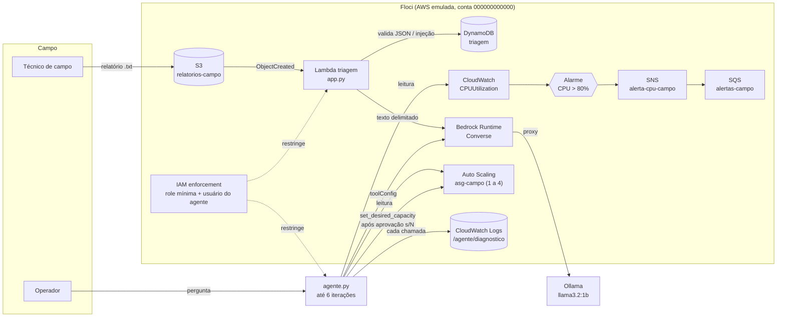

# Arquitetura do protótipo: agronegócio

Grupo: Felipe Pegoraro, Thiago Siena, Pedro Borges

Dois papéis da IA: **componente** (triagem de relatórios, Etapa 4) e **agente** (diagnóstico de Auto Scaling, Etapa 5). Tudo roda no Floci; o Bedrock é atendido pelo Ollama local.

## Controles de segurança no desenho

| Ponto | Controle |
|---|---|
| Lambda | Role com só `s3:GetObject`, `dynamodb:PutItem`, `bedrock:InvokeModel` (1 modelo) e logs próprios; teste negativo comprovou `AccessDenied`. |
| Prompt | Relatório delimitado em `<relatorio>`, saída validada (`baixa\|media\|alta`), 2 tentativas, depois `revisao_humana`; texto com ordem embutida → `revisao_humana`. |
| Agente | Usuário IAM próprio; trava no código (só `asg-campo`, 1..4); aprovação humana para escrita; máx. 6 iterações; diagnóstico recusado sem métricas; log de cada ferramenta. |

## Na AWS real

O mesmo código roda trocando só o endpoint. O Bedrock passa a usar um modelo real (ex.: Nova Micro), o agente pode ir para o AgentCore Runtime, as métricas vêm do EC2 automaticamente e o CloudTrail registra cada chamada de API.
